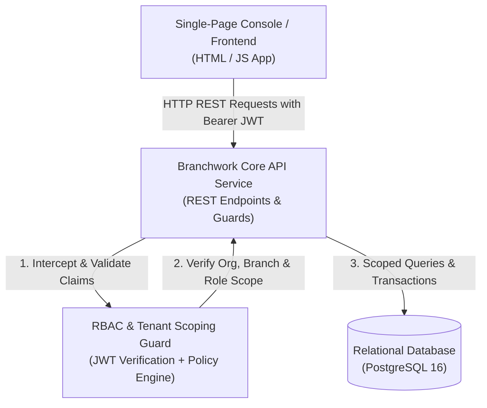
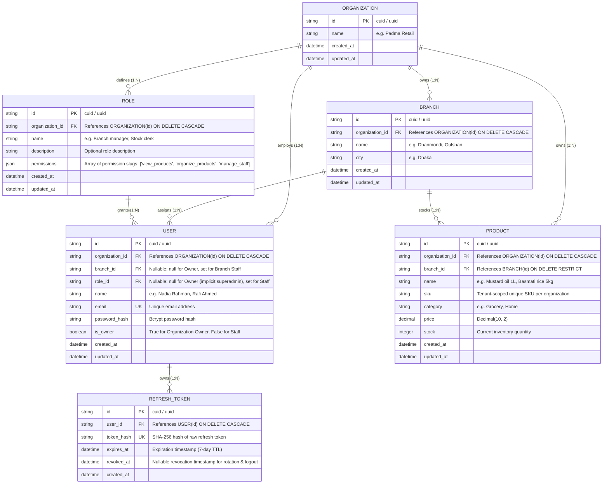

# Branchwork Architecture & Entity-Relationship Design (ERD)

## 1. System Overview

**Branchwork** is a multi-tenant, multi-branch retail organization console providing role-based access control (RBAC), branch-level data scoping, and product inventory management.

---

## 2. High-Level Architecture (C2 Container View)

---

## 3. Entity-Relationship Diagram (ERD)

---

## 4. Multi-Tenancy & Data Isolation Rules

### A. Organization Isolation (Tenant Boundary)
Every table (`BRANCH`, `ROLE`, `USER`, `PRODUCT`) maintains an explicit `organization_id` foreign key.
* **Strict Tenant Context:** An API request can **NEVER** read or modify records where `organization_id != currentUser.organization_id`.
* The `organization_id` is extracted directly from the verified cryptographic JWT payload (never trusted from query params or request bodies).
* **Tenant-Scoped SKU Uniqueness:** Product SKUs are unique per organization (`@@unique([organizationId, sku])`), not globally. This prevents cross-tenant collisions and enables distinct retail tenants to use standard vendor barcodes (e.g., both Tenant A and Tenant B can stock `OIL-001` without collision, but Tenant A cannot duplicate it).

### B. Branch-Level Scoping (Staff Restriction)
* **Owner (`is_owner == true`):**
  * Global access across all branches.
  * Can query all products or filter by specific branch: `GET /api/products?branchId=...`.
  * Only the Owner has permission to **Create** (`POST /api/products`) and **Delete** (`DELETE /api/products/:id`).
* **Staff Member (`is_owner == false`):**
  * Permanently scoped to their assigned `branch_id`.
  * Querying `GET /api/products` **automatically injects** `WHERE branch_id = currentUser.branch_id`.
  * Staff cannot query or see products belonging to other branches.
  * **Unassigned Staff Guard:** Staff accounts without an assigned branch (`branchId == null`) are explicitly rejected with `403 Forbidden` on catalog queries to prevent data leaks.

### C. Permission Checklist & Delegation Limits

| Permission Slug | Description | Granted to Owner? | Granted to Branch Manager? | Granted to Stock Clerk? |
| :--- | :--- | :---: | :---: | :---: |
| `manage_staff` | Invite staff (`POST /api/staff`) and view staff list (`GET /api/staff`) | Yes (Implicit) | Yes | No |
| `view_products` | View product catalog and inventory for assigned branch | Yes (Implicit) | Yes | Yes |
| `organize_products` | Update category, adjust stock count, or reassign branch | Yes (Implicit) | Yes | Yes |
| `create_product` | Add new product SKU to the organization | **Yes Only** | No | No |
| `delete_product` | Remove a product permanently from the organization | **Yes Only** | No | No |

* **IAM Delegation Ceiling:** When a non-owner actor with `manage_staff` invites or assigns a role to a staff member, the service enforces that the target role cannot contain any permissions the actor does not possess (`assertCanAssignRole`), preventing horizontal or vertical privilege escalation (CWE-269).

---

## 5. API Endpoint Specifications

### 1. Authentication
* `POST /api/auth/register-org`
  * **Payload:** `{ organizationName, ownerName, email, password }`
  * **Action:** Atomic transaction creating `Organization` + `User(is_owner=true)`. Returns access token (15m), refresh token (7d), and user profile.
* `POST /api/auth/login`
  * **Payload:** `{ email, password }`
  * **Returns:** `{ accessToken, refreshToken, user }`
* `POST /api/auth/refresh`
  * **Payload:** `{ refreshToken }`
  * **Action:** Validates refresh token hash in PostgreSQL, rotates the token pair (revokes old token, issues fresh token pair), and returns new `{ accessToken, refreshToken }`.
* `POST /api/auth/logout`
  * **Payload:** `{ refreshToken }`
  * **Action:** Atomically revokes refresh token by recording `revokedAt = NOW()`.
* `GET /api/auth/me`
  * **Header:** `Authorization: Bearer <accessToken>`
  * **Returns:** Current session profile with active permissions and branch assignment.

### 2. Branches (Owner Only)
* `GET /api/branches`: List all branches in the organization (with user and product counts).
* `POST /api/branches`: Create a new branch `{ name, city }`.
* `DELETE /api/branches/:id`: Delete branch. Verifies active staff and product counts via `_count` aggregation and returns `409 Conflict` if dependencies exist, preventing accidental data loss.

### 3. Roles & Permissions (Owner Only)
* `GET /api/roles`: List roles with permission checklists and staff counts.
* `POST /api/roles`: Create custom role `{ name, description, permissions: [...] }`.
* `DELETE /api/roles/:id`: Delete role.

### 4. Staff Management
* `GET /api/staff` (Owner or Staff with `manage_staff`): List staff members (with assigned branch and role).
* `POST /api/staff` (Owner or Staff with `manage_staff`): Invite staff `{ name, email, password, branchId, roleId }`. Enforces delegation ceiling check.
* `DELETE /api/staff/:id` (Owner Only): Remove staff member.

### 5. Products & Inventory
* `GET /api/products`
  * **Owner:** Returns all products across org (supports optional `?branchId=...`, case-insensitive search `?search=...`, and pagination `?page=...&limit=...`).
  * **Staff:** Returns **only** products where `branchId == currentUser.branchId` (supports case-insensitive search and pagination). Unassigned staff rejected with `403 Forbidden`.
* `POST /api/products` (Owner Only)
  * Create product `{ name, sku, category, price, stock, branchId }`. Checks tenant-scoped SKU uniqueness.
* `DELETE /api/products/:id` (Owner Only)
  * Permanently remove a product.
* `PATCH /api/products/:id/organize` (Owner OR Staff with `organize_products`)
  * Allowed payload: `{ category, stock, branchId }`.
  * **Enforcement:** If caller is staff, target product's current `branchId` must match `currentUser.branchId`. Reassignment validates that destination branch belongs to the caller's organization.

---

## 6. Security, JWT & Configuration Architecture

### A. Token Lifecycle & Session Management
Authentication uses a dual-token strategy:
* **Access Tokens:** Short-lived (15 minutes) HMAC-SHA256 tokens carrying claims (`organizationId`, `branchId`, `isOwner`, `permissions`).
* **Refresh Tokens:** Long-lived (7 days), cryptographically random 40-byte hex strings stored in PostgreSQL as SHA-256 hashes (`tokenHash`).
* **Token Reuse Detection:** If an already-revoked refresh token is presented, the system detects potential token theft and immediately revokes all active refresh sessions for that user.

### B. Environment Configuration & Secrets Management
Configuration is strictly validated using NestJS `ConfigService`:
* `JWT_SECRET`: Secret key loaded via `configService.getOrThrow<string>("JWT_SECRET")`. Fails fast on application boot if unset; zero hardcoded fallback secrets in application code.
* `JWT_EXPIRES_IN`: Token lifespan parsed from environment (defaults to `"15m"`).
* `DATABASE_URL`: PostgreSQL connection string with schema scoping (`schema=public`).
* `PORT`: HTTP server port (defaults to `3000`).
* `NODE_ENV`: Runtime mode (`development`, `production`, `test`).

### C. Container Orchestration & Migrations
* **PostgreSQL Container (`branchwork-postgres`):** Runs PostgreSQL 16 Alpine with persistent volume `pgdata`. Health check (`pg_isready -U postgres`) runs every 5 seconds.
* **API Container (`branchwork-api`):** Multi-stage Docker build. On container boot, runs `pnpm prisma migrate deploy` non-interactively to safely apply version-controlled SQL migrations before starting the Node process.

---

## 7. Architectural Decision Records (ADR)

### ADR-001: NestJS over FastAPI
* **Context:** The role specification allowed either FastAPI or NestJS for this API.
* **Decision:** We chose NestJS with TypeScript and Prisma.
* **Consequences:** Declarative guards (`RolesGuard`, `JwtAuthGuard`) handle tenant isolation and branch-scoped authorization at the controller boundary, keeping business logic clean. TypeScript interfaces and DTOs wire directly into OpenAPI (`/api/docs`) without duplicate schema maintenance.

### ADR-002: Multi-Tenant JWT Claim Scoping
* **Context:** Preventing horizontal privilege escalation across multi-tenant boundaries.
* **Decision:** Extract `organizationId` strictly from the cryptographically verified JWT session.
* **Consequences:** Clients cannot override tenant scope via URL query parameters or request body parameters.

### ADR-003: Safe Branch Deletion (`onDelete: Restrict`)
* **Context:** Preventing catastrophic inventory data loss when an owner deletes a store branch.
* **Decision:** Enforce `onDelete: Restrict` in PostgreSQL schema and verify active dependency counts in `BranchesService` via `_count` aggregation before deletion.
* **Consequences:** If a branch contains active staff or products, the API returns a descriptive `409 Conflict`, preventing accidental data loss and raw database foreign key errors.

### ADR-004: Decimal Precision for Currency
* **Context:** Standard floating-point numbers (`Float`) cause rounding errors with money (e.g., `0.1 + 0.2 = 0.30000000000000004`).
* **Decision:** Store product prices as `Decimal @db.Decimal(10, 2)` in PostgreSQL.
* **Consequences:** Eliminates rounding bugs in product prices and order totals. The API converts Prisma Decimal to standard numbers when serializing JSON responses.

### ADR-005: Version-Controlled Migrations & Deterministic Deployments
* **Context:** `prisma db push` is suited for early prototyping but lacks an auditable SQL change history and can cause accidental data loss in production.
* **Decision:** Adopt version-controlled migrations via `prisma/migrations/` and execute `prisma migrate deploy` in container startup.
* **Consequences:** All schema changes are tracked as immutable SQL files in Git. Docker containers apply migrations predictably without interactive prompts.

### ADR-006: Production Token Rotation & Session Revocation
* **Context:** Pure stateless 24-hour JWT tokens cannot be revoked if stolen, creating an unacceptable blast radius.
* **Decision:** Implement short-lived access tokens (15m) paired with database-backed refresh tokens (7d) using cryptographic SHA-256 hashing and atomic rotation.
* **Consequences:** Sessions can be revoked instantly upon logout. Token reuse detection protects accounts from stolen token replay attacks.

### ADR-007: IAM Delegation Ceilings in Role Assignments
* **Context:** Allowing non-owner managers to invite staff without bounds introduces vertical privilege escalation risks (CWE-269).
* **Decision:** Implement `assertCanAssignRole` to verify that non-owners cannot assign any permission they do not personally hold.
* **Consequences:** Store managers can delegate operational duties to subordinates without the risk of creating accounts with elevated administrative rights.
