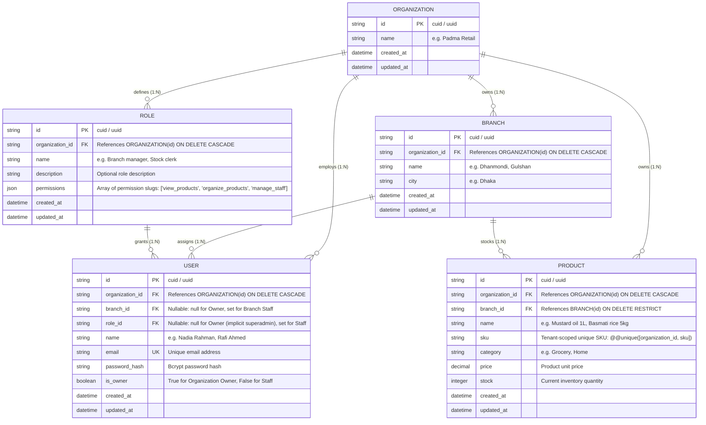

# Branchwork Architecture & Entity-Relationship Design (ERD)

## 1. System Overview

**Branchwork** is a multi-tenant, multi-branch organization console providing role-based access control (RBAC), branch-level data scoping, and product inventory management.

---

## 2. High-Level Architecture (C2 Container View)

```mermaid
flowchart TD
    Client["Single-Page Console / Frontend\n[HTML / JS App]"]
    API["Branchwork Core API Service\n[REST Endpoints & Guards]"]
    AuthGuard["RBAC & Tenant Scoping Guard\n[JWT Verification + Policy Engine]"]
    DB[(Relational Database\n[PostgreSQL 16])]

    Client -->|HTTP REST Requests with Bearer JWT| API
    API -->|1. Intercept & Validate Claims| AuthGuard
    AuthGuard -->|2. Verify Org, Branch & Role Scope| API
    API -->|3. Scoped Queries & Transactions| DB
```

---

## 3. Entity-Relationship Diagram (ERD)



---

## 4. Multi-Tenancy & Data Isolation Rules

### A. Organization Isolation (Tenant Boundary)
Every table (`BRANCH`, `ROLE`, `USER`, `PRODUCT`) maintains an explicit `organization_id` foreign key.
* **Strict Tenant Context:** An API request can **NEVER** read or modify records where `organization_id != currentUser.organization_id`.
* The `organization_id` is extracted directly from the verified cryptographic JWT payload—never trusted from query params or client body.
* **Tenant-Scoped SKU Uniqueness:** Product SKUs are unique per organization (`@@unique([organizationId, sku])`), not globally. This prevents cross-tenant collisions and denial-of-service, enabling distinct retail tenants to use standard barcodes or item numbers (e.g., both Tenant A and Tenant B can stock `OIL-001`).

### B. Branch-Level Scoping (Staff Restriction)
* **Owner (`is_owner == true`):**
  * Global access across all branches.
  * Can query all products or filter by specific branch: `GET /api/products?branchId=...`.
  * Only the Owner has permission to **Create** (`POST /api/products`) and **Delete** (`DELETE /api/products/:id`).
* **Staff Member (`is_owner == false`):**
  * Permanently scoped to their assigned `branch_id`.
  * Querying `GET /api/products` **automatically injects** `WHERE branch_id = currentUser.branch_id`.
  * Staff cannot query or see products belonging to other branches.
  * **Unassigned Staff Guard:** Staff accounts without an assigned branch (`branchId == null`) are explicitly rejected with `403 Forbidden` on catalog queries to prevent data leaks.

### C. Permission Checklist Matrix

| Permission Slug | Description | Granted to Owner? | Granted to Branch Manager? | Granted to Stock Clerk? |
| :--- | :--- | :---: | :---: | :---: |
| `manage_staff` | View organization staff list (`GET /api/staff`) | Yes (Implicit) | Yes | No |
| `view_products` | View product catalog and inventory for assigned branch | Yes (Implicit) | Yes | Yes |
| `organize_products` | Update category, adjust stock count, or reassign branch | Yes (Implicit) | Yes | Yes |
| `create_product` | Add new product SKU to the organization | **Yes Only** | No | No |
| `delete_product` | Remove a product permanently from the organization | **Yes Only** | No | No |

> **Note:** Staff invitation (`POST /api/staff`) and deletion (`DELETE /api/staff/:id`) are strictly restricted to `@RequireOwner()` to prevent cross-branch privilege escalation.

---

## 5. API Endpoint Specifications

### 1. Authentication
* `POST /api/auth/register-org`
  * **Payload:** `{ organizationName, ownerName, email, password }`
  * **Action:** Atomic transaction creating `Organization` + `User(is_owner=true)`. Returns JWT and normalized user object (`permissions: ["*"]`, `roleName: "Owner"`).
* `POST /api/auth/login`
  * **Payload:** `{ email, password }`
  * **Returns:** `{ accessToken, user: { id, name, email, isOwner, organizationId, organizationName, branchId, branchName, roleId, roleName, permissions } }`
* `GET /api/auth/me`
  * **Header:** `Authorization: Bearer <token>`
  * **Returns:** Current session profile with active permissions and branch assignment.

### 2. Branches (Owner Only)
* `GET /api/branches` — List all branches in the organization (with user and product counts).
* `POST /api/branches` — Create a new branch `{ name, city }`.
* `DELETE /api/branches/:id` — Delete branch. Verifies active product count and throws `409 Conflict` if products exist (`Cannot delete branch '...'. It contains X active products. Reassign or delete products first.`), preventing unhandled PostgreSQL foreign key errors.

### 3. Roles & Permissions (Owner Only)
* `GET /api/roles` — List roles with their permission checklists and staff counts.
* `POST /api/roles` — Create custom role `{ name, description, permissions: [...] }`.
* `DELETE /api/roles/:id` — Delete role.

### 4. Staff Management
* `GET /api/staff` (Owner or Staff with `manage_staff`) — List staff members (with assigned branch and role).
* `POST /api/staff` (Owner Only) — Invite/add staff `{ name, email, password, branchId, roleId }`.
* `DELETE /api/staff/:id` (Owner Only) — Remove staff member.

### 5. Products & Inventory
* `GET /api/products`
  * **Owner:** Returns all products across org (supports optional `?branchId=...`, case-insensitive search `?search=...`, and pagination `?page=...&limit=...`).
  * **Staff:** Returns **only** products where `branchId == currentUser.branchId` (supports case-insensitive search and pagination). Unassigned staff rejected with `403 Forbidden`.
* `POST /api/products` (Owner Only)
  * Create product `{ name, sku, category, price, stock, branchId }`. Checks tenant-scoped SKU uniqueness.
* `DELETE /api/products/:id` (Owner Only)
  * Permanently remove a product.
* `PATCH /api/products/:id/organize` (Owner OR Staff with `organize_products`)
  * Allowed payload: `{ category, stock, branchId }`.
  * **Enforcement:** If caller is staff, target product's current `branchId` must match `currentUser.branchId`. Reassignment validates that destination branch belongs to the caller's organization.

---

## 6. Security, JWT & Configuration Architecture

### A. JWT Architecture & Scoping Claims
Authentication uses cryptographically signed JSON Web Tokens (HMAC-SHA256):
```typescript
interface JwtPayload {
  sub: string;            // User CUID
  email: string;          // User email
  organizationId: string; // Tenant boundary (immutable claim)
  branchId: string | null;// Assigned branch (null for Owner)
  roleId: string | null;  // Assigned role (null for Owner)
  roleName: string | null;// Role name
  isOwner: boolean;       // Owner status flag
}
```
* **Tamper-Proof Scoping:** The `organizationId` and `branchId` in requests are sourced exclusively from the validated JWT token by `JwtStrategy` and `CurrentUser` decorator. Clients cannot override their scope via query parameters or body payloads.

### B. Environment Configuration & Secrets Management
Configuration is strictly validated using NestJS `ConfigService`:
* `JWT_SECRET`: Mandatory secret key loaded via `configService.getOrThrow<string>("JWT_SECRET")`. Fails fast on application boot if unset; zero hardcoded fallback secrets in application code.
* `JWT_EXPIRES_IN`: Token lifespan dynamically parsed from environment (defaults to `"1d"`).
* `DATABASE_URL`: PostgreSQL connection string with schema scoping (`schema=public`).
* `PORT`: HTTP server port (defaults to `3000`).
* `NODE_ENV`: Runtime mode (`development`, `production`, `test`).

### C. Container Orchestration (`compose.yaml`)
* **PostgreSQL Container (`branchwork-postgres`):** Runs PostgreSQL 16 Alpine with persistent volume `pgdata`. Health check (`pg_isready -U postgres`) runs every 5 seconds.
* **API Container (`branchwork-api`):** Builds via multi-stage `Dockerfile`. Uses `depends_on: { postgres: { condition: service_healthy } }` to ensure database readiness before starting migrations and NestJS.

---

## 7. Architectural Decision Records (ADR)

### ADR 1: NestJS over FastAPI
* **Context:** The role specification allowed either FastAPI or NestJS for this API.
* **Decision:** We chose NestJS with TypeScript and Prisma.
* **Consequences:** Guards (`RolesGuard`, `JwtAuthGuard`) handle tenant isolation and branch-scoped authorization before route handlers run, keeping business logic clean. TypeScript interfaces and DTOs wire directly into OpenAPI (`/api/docs`) without duplicate schema maintenance.
