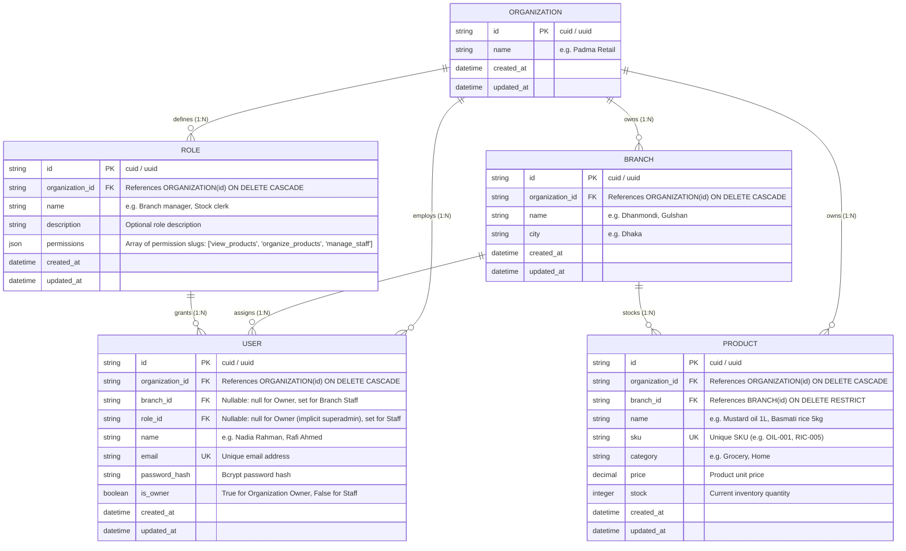

# Branchwork Architecture & Entity-Relationship Design (ERD)

## 1. System Overview

**Branchwork** is a multi-tenant, multi-branch organization console providing role-based access control (RBAC), branch-level data scoping, and product inventory management.

---

## 2. High-Level Architecture (C2 Container View)

```mermaid
flowchart TD
    Client["Single-Page Console / Frontend\n[HTML / JS App]"]
    API["Branchwork Core API Service\n[REST Endpoints & Guards]"]
    AuthGuard["RBAC & Tenant Scoping Guard\n[JWT Verification + Policy Engine]"]
    DB[(Relational Database\n[PostgreSQL / SQLite])]

    Client -->|HTTP REST Requests with Bearer JWT| API
    API -->|1. Intercept & Validate Claims| AuthGuard
    AuthGuard -->|2. Verify Org, Branch & Role Scope| API
    API -->|3. Scoped Queries & Transactions| DB
```

---

## 3. Entity-Relationship Diagram (ERD)



---

## 4. Multi-Tenancy & Data Isolation Rules

### A. Organization Isolation (Tenant Boundary)
Every table (`BRANCH`, `ROLE`, `USER`, `PRODUCT`) maintains an explicit `organization_id` foreign key.
* **Rule:** An API request can **NEVER** read or modify records where `organization_id != currentUser.organization_id`.
* The `organization_id` is extracted directly from the verified cryptographic JWT payload—never trusted from query params or client body.

### B. Branch-Level Scoping (Staff Restriction)
* **Owner (`is_owner == true`):**
  * Global access across all branches.
  * Can query all products or filter by specific branch: `GET /api/products?branch_id=...`.
  * Only the Owner has permission to **Create** (`POST /api/products`) and **Delete** (`DELETE /api/products/:id`).
* **Staff Member (`is_owner == false`):**
  * Permanently scoped to their assigned `branch_id`.
  * Querying `GET /api/products` **automatically injects** `WHERE branch_id = currentUser.branch_id`.
  * Staff cannot query or see products belonging to other branches.

### C. Permission Checklist Matrix

| Permission Slug | Description | Granted to Owner? | Granted to Branch Manager? | Granted to Stock Clerk? |
| :--- | :--- | :---: | :---: | :---: |
| `manage_staff` | Create, update, or remove branch staff members | Yes (Implicit) | Yes | No |
| `view_products` | View product catalog and inventory for assigned branch | Yes (Implicit) | Yes | Yes |
| `organize_products` | Update category, adjust stock count, or reassign branch | Yes (Implicit) | Yes | Yes |
| `create_product` | Add new product SKU to the organization | **Yes Only** | No | No |
| `delete_product` | Remove a product permanently from the organization | **Yes Only** | No | No |

---

## 5. API Endpoint Specifications

### 1. Authentication
* `POST /api/auth/register-org`
  * **Payload:** `{ organizationName, ownerName, email, password }`
  * **Action:** Atomic transaction creating `Organization` + `User(is_owner=true)`. Returns JWT.
* `POST /api/auth/login`
  * **Payload:** `{ email, password }`
  * **Returns:** `{ accessToken, user: { id, name, email, isOwner, organizationId, branchId, role } }`
* `GET /api/auth/me`
  * **Header:** `Authorization: Bearer <token>`
  * **Returns:** Current session profile with active permissions.

### 2. Branches (Owner Only)
* `GET /api/branches` — List all branches in the organization.
* `POST /api/branches` — Create a new branch `{ name, city }`.
* `PUT /api/branches/:id` — Update branch name or city.
* `DELETE /api/branches/:id` — Delete branch.

### 3. Roles & Permissions (Owner Only)
* `GET /api/roles` — List roles with their permission checklists and staff counts.
* `POST /api/roles` — Create role `{ name, description, permissions: [...] }`.
* `PUT /api/roles/:id` — Update role permissions.
* `DELETE /api/roles/:id` — Delete role.

### 4. Staff Management (Owner or Staff with `manage_staff`)
* `GET /api/staff` — List staff members (with assigned branch and role).
* `POST /api/staff` — Invite/add staff `{ name, email, password, branchId, roleId }`.
* `PUT /api/staff/:id` — Update staff branch assignment or role.
* `DELETE /api/staff/:id` — Remove staff member.

### 5. Products & Inventory
* `GET /api/products`
  * **Owner:** Returns all products across org (supports optional `?branch_id=...` and search `?q=...`).
  * **Staff:** Returns **only** products where `branch_id == currentUser.branch_id`.
* `POST /api/products` (Owner Only)
  * Create product `{ name, sku, category, price, stock, branchId }`.
* `DELETE /api/products/:id` (Owner Only)
  * Permanently remove a product.
* `PATCH /api/products/:id/organize` (Owner OR Staff with `organize_products`)
  * Allowed payload: `{ category, stock, branchId }`.
  * **Enforcement:** If caller is staff, target product's current `branch_id` must match `currentUser.branch_id`.

---

## 6. Key Decisions (ADR)

### ADR 1: NestJS over FastAPI
* **Context:** The role specification allowed either FastAPI or NestJS for this API.
* **Decision:** We chose NestJS with TypeScript and Prisma.
* **Consequences:** Guards (`RolesGuard`, `JwtAuthGuard`) handle tenant isolation and branch-scoped authorization before route handlers run, keeping business logic clean. TypeScript interfaces and DTOs wire directly into OpenAPI (`/api/docs`) without duplicate schema maintenance.

### ADR 2: Runtime and Containers
* **Context:** Reviewers run different package managers (npm, pnpm, bun) and container engines (Docker, Podman).
* **Decision:** We locked Node.js 24 in `.node-version` and `engines`, supported SQLite for instant local runs, and provided `compose.yaml` for containerized runs.
* **Consequences:** Zero global configuration required to review the code locally. Reviewers can test via standard `npm install` / `bun install`, or run the full stack with `docker compose up --build` or `podman compose up --build`.
